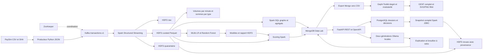
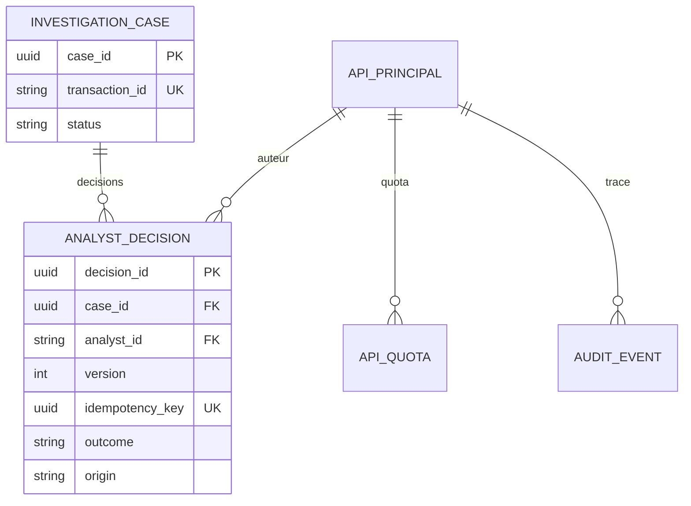

# Architecture BC1

État au 17 novembre 2026 : architecture locale implémentée et chaîne principale exécutée ; critères transversaux encore ouverts. Les obligations et leurs sources restent dans [audit.md](audit.md). Les compléments PostgreSQL/API répondent au référentiel ; les choix précis ci-dessous sont des décisions techniques du projet.

## Contexte métier

Une équipe de démonstration rejoue PaySim, détecte des opérations à examiner, explore les relations entre comptes et prépare une communication. PaySim est synthétique. Un score non calibré, une communauté ou un hub n'établissent ni une fraude réelle ni du blanchiment. Les décisions automatisées de test sont distinguées de toute revue humaine.

## Flux réellement implémenté

Les modèles lisent les transactions canoniques HDFS, avec toutes les lignes individuelles. Mongo reçoit les résultats de consultation. Gephi utilise effectivement l'export Mongo. Le lac reçoit une seconde source SQL ; les labels PaySim ne sont jamais fournis au LLM. Aucun email n'est transmis.

## Composants et arbitrages

| Composant | Rôle et choix | Alternative et limite |
|---|---|---|
| Docker Compose | Laboratoire reproductible, réseau interne, volumes persistants | Kubernetes appartient au BC3 ; Compose seul ne fournit aucune HA |
| Kafka 3.9.2 + ZooKeeper | Rejeu durable, topic à trois partitions, accusés `acks=all` | Version archivée retenue pour ZooKeeper du sujet ; dette de maintenance à examiner ; réplication 1 |
| Spark 3.5.8 | PySpark/SQL, micro-batch 5 s ou `availableNow`, MLlib | Pas de moteur continu événementiel distinct ; dépassements du trigger observés |
| Hadoop HDFS 3.4.3, Java 11 | Raw, Parquet typé, checkpoints et artefacts modèles | Un NN/un DN, réplication 1 ; mode simple sans authentification forte |
| MongoDB 8.0.38 | Agrégats, nœuds/arêtes, scores et texte généré | Cassandra possible mais exploitation plus lourde pour ce laboratoire ; pas de replica set |
| PostgreSQL 17.12 | Intégrité relationnelle, décisions, identités, quotas et audit | MySQL possible ; ne pas dupliquer tout le lac en SQL ; instance unique |
| FastAPI | Validation, API REST/JSON, OpenAPI, bearer tokens/rôles | API volontairement bornée ; pas d'interface client complète ni TLS |
| Gephi Toolkit 0.11.4 | Degré, modularité et rendus du moteur Gephi | Client Linux exécuté et capturé ; rendu Toolkit et capture d’interface distingués |
| Ollama / Qwen 3.1B Q4_K_M | Génération locale sur faits bornés | 1.5B essayé mais non conforme ; 3B sous licence recherche/évaluation non commerciale ; pas de garantie sémantique |

Références d'images par digest dans `infra/images.lock.json`, dépendances Python avec hashes dans les fichiers requirements, connecteurs dans `infra/connectors.lock.json`, 150 JAR Gephi dans `infra/gephi/artifacts.sha256.json`, modèle LLM dans `infra/llm.lock.json`. Les hashes ne remplacent ni les signatures ni un audit de vulnérabilités. Les versions effectivement exécutées sont dans [compatibility.md](compatibility.md).

## Contrats, horloges et modèles de stockage

### Transaction

Onze colonnes PaySim vérifiées par profilage intégral. Montants exacts en `Decimal(18,2)`, deux décimales au plus sans arrondi silencieux, unité monétaire non précisée. Les 16 montants nuls du fichier sont conservés.

Enveloppe v1 : `schema_version`, `dataset_id`, `source_row`, `transaction_id`, `replay_run_id`, `event_time`, `emitted_at`, `event_time_synthetic`, `payload`. ID SHA-256 de l'empreinte dataset et de la position source ; stable à travers les rejeux. La provenance déclarée n'est pas une signature cryptographique de chaque payload. Le producteur est une source de laboratoire de confiance ; Kafka n'est pas authentifié dans ce profil.

Le step est une heure de simulation. `event_time = 2000-01-01 UTC + (step-1) heures`, explicitement synthétique ; aucun instant intrahoraire natif inventé. `emitted_at` est l'instant réel du rejeu, `ingested_at` le timestamp logique du micro-batch Spark. Leur différence **exclut le commit du sink et la visibilité d'une lecture**. Les agrégats minute utilisent l'horloge d'émission réelle, pas les heures simulées.

### HDFS et reprise

Chemins : `/bc1/<run>/{raw,curated,quarantine,metrics,checkpoints}` et `/bc1/<training-run>/models/<version>`. Métriques complètes par `metrics/batch_id=N`. Revues sous `/bc1/reviews/<snapshot>/{raw,curated,report}`. Les données sont en Parquet ; raw conserve le JSON et les coordonnées Kafka.

Curated valide schéma, identité, types, comptes, labels et décimaux. Déduplication globale par transaction avec état RocksDB/checkpoints ; pas d'expiration de l'identité pendant un rejeu fini. L'état croît avec les transactions : une politique de service infini reste à concevoir. L'absence/corruption d'un checkpoint ne doit pas être traitée comme une remise à zéro silencieuse.

Les requêtes raw/curated/quarantaine ont des checkpoints distincts. En mode permanent, les métriques lisent curated à mesure de sa publication ; en mode borné elles démarrent après la fin des trois requêtes. Les snapshots métriques sont réécrits à la même clé de batch lors d'une reprise. Aucun engagement d'exactly-once inter-stockages n'est formulé.

### MongoDB

`transaction_metrics`, `graph_nodes`, `graph_edges`, `graph_snapshots`, `fraud_scores`, `generated_explanations` et `generation_attempts` pour sorties rejetées. IDs stables et upserts par identité/version. Snapshot de graphe marqué complet seulement après ses écritures ; refus de plus de 50 000 arêtes. Les contrôles vérifient les extrémités et montants lors de l'export. `Weight` est le nombre de transactions ; `TotalAmount` n'est pas le poids utilisé dans l'analyse publiée.

Scores identifiés par SHA-256(version globale modèle + ID transaction). Version globale `training-run:model-version`, score/seuil non calibré, p95 montant calculé uniquement sur train, date et provenance conservés. Le p95 est descriptif, pas une explication causale. Index alertes/temps et transaction/version ; plan réel IXSCAN observé sur la lecture d'alerte.

### PostgreSQL

Tables `investigation_case`, `analyst_decision`, `api_principal`, `audit_event`, `api_quota`. PK, FK décision→dossier/analyste, unicité transaction/dossier, version/dossier et clé d'idempotence ; contraintes d'états et de longueur. `origin=user_review|automated_test` distingue les décisions ; **toutes les décisions produites jusqu'ici sont des tests automatisés**.

La référence SQL→Mongo/HDFS n'est pas une fausse FK relationnelle : l'API vérifie l'alerte et l'extraction JDBC rapproche les transactions HDFS. Les décisions sont immuables pour le rôle applicatif (SELECT/INSERT seuls). Verrou de transaction sur clé d'idempotence puis verrou de dossier : quatre appels simultanés ont donné une création et trois réponses répétées identiques ; conflit de contenu 409.

La source SQL utilise un **snapshot complet immuable et borné à 100 000 revues**, pas une CDC ni un curseur temporel. Ce choix évite de perdre un commit tardif derrière un watermark. Au volume actuel, la simplicité et la cohérence priment ; CDC à étudier si croissance. Deux décisions de test ont réellement été intégrées dans le premier snapshot ; les nouvelles décisions sont capturées dans une nouvelle version.

## API et sécurité de base

| Endpoint | Accès et comportement |
|---|---|
| `GET /health/live`, `/health/ready` | Public, état borné ; ready teste SQL/Mongo, pas un LLM chargé |
| `GET /v1/alerts`, `/v1/alerts/{id}` | Lecteur/analyste ; limites, validation SHA et 404 |
| `GET /v1/metrics`, `/v1/graph/exports` | Lecteur/analyste ; résultats bornés |
| `POST /v1/alerts/{id}/cases` | Analyste ; création idempotente du dossier |
| `POST /v1/cases/{id}/decisions` | Analyste ; `Idempotency-Key` UUID, contraintes et audit |
| `POST /v1/alerts/{id}/explanations` | Analyste ; génération locale réelle, 503 si échec/rejet, aucun envoi |

Bearer tokens opaques hachés SHA-256 en SQL, actifs/révocables, rôles lecteur/analyste. Quota général 60 requêtes/minute/identité, génération 5/minute, compteurs atomiques persistés SQL, 429 avec Retry-After. Quota ne mesure pas la capacité du service. Journal HTTP structuré sans header, paramètres ni corps. API non root, système de fichiers read-only, capacités supprimées ; erreurs stockage bornées, pas de détails de connexion.

Ports exposés sur loopback : API 8000, Spark 8080, HDFS 9870. SQL/Mongo/Kafka/Ollama sans port hôte. Secrets `.env` ignoré, 0600, distincts des comptes propriétaires ; pas de secrets dans les images ou exemples. Tests réels : jeton actif puis révoqué, refus de mots de passe SQL/Mongo et accès anonyme Mongo. Le réseau Docker et les droits HDFS ne remplacent pas Kerberos/TLS. Le profil reste inadapté à une exposition publique.

## ML et génération

Échantillonnage SHA indépendant du label (modulo 64, seed 42) sur le fichier complet ; 98 813 transactions, 141 fraudes, steps complets disjoints : train ≤281, validation 282–355, test >355. Pas de rééquilibrage du test. Poids de classes et prétraitements appris sur train seulement.

Features : log-montant, encodage du type, heure simulée sin/cos. Les quatre soldes sont exclus selon l'avertissement de l'auteur PaySim ; labels et comptes exclus avant l'inférence. LR et RF entraînés ; seuil choisi par F2 validation et modèle par PR-AUC validation. Résultats critiques, limites et matrices dans [rapport ML](evidence/p6/model-comparison.json).

Deux appels LLM séparent les publics : score/seuil pour le conseiller ; référence synthétique seulement pour le message client, afin d'éviter l'invention d'une devise. Exemple de style fourni au prompt et déclaré comme tel ; les sorties présentées proviennent bien des appels au modèle, pas d'un gabarit substitué. Version/digest/prompt/faits/paramètres/timings enregistrés. Contrôles rédactionnels et factuels complétés par une revue technique ; revue humaine avant usage toujours requise. Une première sortie structurée mais parasitée a été reclassée `rejected_quality_review` : un succès HTTP ne suffit pas à valider le texte.

## Ressources, résilience et travaux ouverts

VM observée environ 11,67 Gio, 16 vCPU annoncés ; hôte 16 Go. Worker principal limité à 2 cœurs/1 536 Mio Spark ; driver 768 Mio JVM ; Ollama plafond 4 Gio après pression mémoire au plafond 3 Gio. Éviter les charges lourdes simultanées et consigner les autres services actifs dans les benchmarks. Un second worker est prévu dans le profil `scale` pour comparer une et deux capacités locales ; aucune amélioration présumée.

Reprise Kafka/HDFS, checkpoints, déduplication et quarantaine vérifiées. Arrêt Mongo→503→redémarrage→200 vérifié : c'est une reprise, pas une disponibilité continue. SQL et Mongo restaurés dans des bases distinctes ; données HDFS restaurées dans un chemin distinct et rapprochées. Ces essais restent sur le même hôte, pas une reprise après sinistre ; sauvegardes chiffrées/hors hôte et restauration des modèles/checkpoints restent ouvertes.

Pour revendiquer C1.4 complètement : réplication/bascule réellement testée des composants critiques et périmètre de continuité explicite. Profil Kafka 3 brokers/ISR et HDFS NN HA/JournalNodes/ZKFC à construire et éprouver ; ne pas présenter plusieurs conteneurs mono-hôte comme tolérance à la perte de l'hôte. Authentification forte HDFS, SASL/ACL Kafka, TLS et accès Spark restent également ouverts C1.3/P8. Aucun service cloud ou achat implicitement autorisé.

La reproductibilité complète depuis volumes neufs, les captures du client Linux sont obtenues ; les contrôles de vulnérabilités et la répétition jury restent à terminer. Les seuls documents communs aux blocs sont les PDF de référence ; aucun code ou déploiement BC2/BC3 n'est créé.

## Runtime HDFS mis à jour

Le principal utilise Hadoop 3.4.3/Temurin 11.0.33/Ubuntu 24.04.5, après tests isolés, copie cohérente et reprise demandée par l'utilisateur. `COMPOSE_FILE` charge durablement l'override de runtime ; les anciens digests 3.4.2 restent des références historiques/de secours dans la configuration de base. [Migration et preuves](hadoop-runtime.md). Spark conserve Java 17 et ses clients Hadoop 3.3.4 ; les versions serveur/client sont distinguées. Cette mise à jour n'active pas Kerberos/TLS et ne démontre aucune HA supplémentaire.
