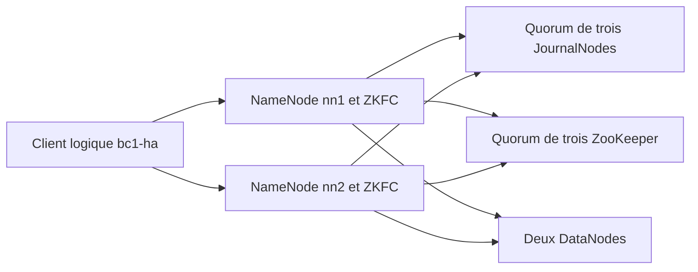

# Résilience HDFS locale

Deux NameNodes avec ZKFC, trois JournalNodes QJM, trois ZooKeeper et deux DataNodes isolés du principal. Réplication des blocs : deux. L'authentification HDFS reste simple sur réseau interne ; ce profil est distinct du profil Kerberos. Aucun port hôte publié ni volume métier partagé.



## Résultats exécutés

Le client Java écrit et ferme 80 fichiers synthétiques identifiés, attend l'injection d'une panne après cinq acquittements, puis relit chaque octet. Le processus Java actif reçoit SIGKILL, sans arrêter SSH ou ZKFC. Deux sens de bascule ont été observés : nn1 vers nn2, puis nn2 vers nn1. Chaque essai retrouve 80 fichiers distincts, sans acquittement perdu. Durées maximales d'écriture : 4,023 s puis 11,236 s. Ce sont des observations de deux essais locaux, pas un SLA ni une mesure universelle de RTO. [Chronologie 1](evidence/p8/hdfs-ha/continuity.json), [chronologie 2](evidence/p8/hdfs-ha/continuity-v2.json), [protocole et contrôles](evidence/p8/hdfs-ha/experiment.json).

Le fencing utilise SSH avec clés générées en volumes, vérification stricte des clés d'hôtes et commande forcée limitée à fuser/nc. Un appel distinct a réellement tué le processus du standby, puis vérifié la fermeture du port. Une commande arbitraire a été refusée avec le code 126. La première vérification nc visait le loopback, alors que RPC écoute l'adresse du conteneur : correction vers le nom configuré, contrôle positif avant arrêt et négatif après arrêt exécutés. Ces contrôles ne prouvent pas que l'élection automatique a dû invoquer le fencer lors des deux pannes.

## Reproduction et exploitation

Depuis `bc1/`, construire d'abord l'image sécurisée parente selon `infra/secure-hdfs/Dockerfile`, puis :

```sh
docker compose -f infra/hdfs-ha/compose.yml build
docker compose -f infra/hdfs-ha/compose.yml up -d --wait
docker compose -f infra/hdfs-ha/compose.yml exec -T nn1 hdfs haadmin -getAllServiceState
docker compose -f infra/hdfs-ha/compose.yml run --rm --no-deps probe probe NOUVEAU_RUN
```

Dans un second terminal, après `ha_probe_ready`, déterminer le NameNode actif puis exécuter `docker compose -f infra/hdfs-ha/compose.yml exec -T nn1 python3 /scripts/inject_fault.py NOUVEAU_RUN` en remplaçant nn1 si nécessaire. Le client attend au maximum 180 secondes le signal d'injection. Un identifiant déjà utilisé est refusé pour éviter de confondre les essais. Récupérer `/control/NOUVEAU_RUN/result.json` puis redémarrer le NameNode arrêté et vérifier son retour standby. Arrêter le profil avec `stop`, sans supprimer les volumes.

## Choix et limites

QJM conserve un journal partagé majoritaire, ZooKeeper arbitre l'élection, ZKFC surveille et promeut. Une alternative est un service HDFS géré ou un déploiement multi-hôtes ; son coût et son exploitation dépassent ce laboratoire. Les clés de fencing donnent un pouvoir d'arrêt ciblé : rotation, protection des volumes et audit sont nécessaires. La réplication n'est pas une sauvegarde. Les services partagent le même hôte et les mêmes ressources Docker. Ni la perte physique de l'hôte, ni une HA sécurisée combinant ce profil avec Kerberos, ni une HA de SQL/Mongo/API n'ont été démontrées.
