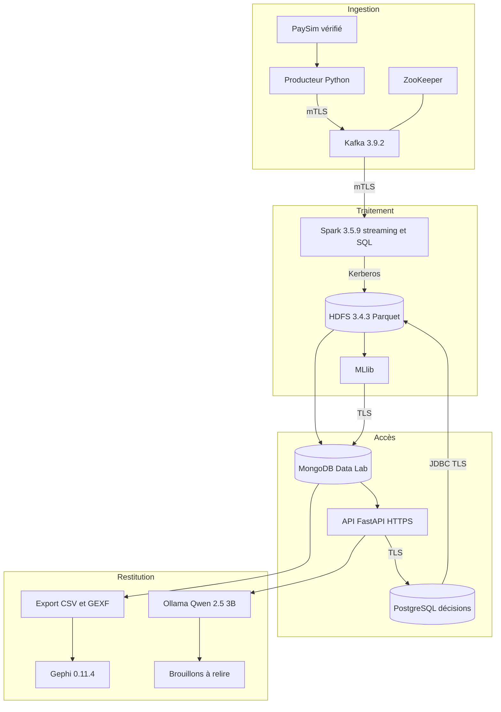
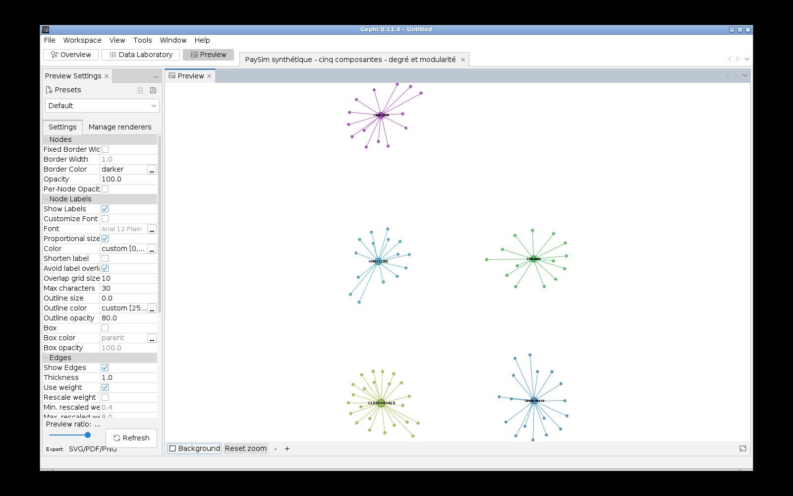

# Architecture Big Data et détection de fraude

## Besoin

Un analyste bancaire doit repérer des paiements suspects, comprendre les liens entre comptes et expliquer une alerte au client. La plateforme rejoue des transactions synthétiques, les conserve avec leur provenance, calcule des agrégats, analyse le réseau des comptes, compare deux modèles de détection et fait rédiger un brouillon d’explication par un LLM local. Elle ne décide pas qu’un client est fraudeur et n’envoie aucun email.

| Source | Exigences retenues |
|---|---|
| Sujet BC1 | Docker Compose ; Kafka avec ZooKeeper ; HDFS ; Spark master/worker, PySpark et Spark SQL ; MongoDB ou Cassandra ; Gephi ; MLlib (régression logistique contre Random Forest, AUC, matrice de confusion, rappel) ; agent IA (explication + email) ; dépôt GitHub, rapport avec captures Gephi, démonstration |
| Référentiel C1.1–C2.4 | Base relationnelle normalisée, NoSQL justifié, sources variées, KPI de transfert, sécurité, haute disponibilité, API authentifiée avec autorisations et quotas, micro-batch, optimisation |
| Recommandations techniques ajoutées | Chiffrement de bout en bout, tests de panne, contrôles d’accessibilité de l’interface |

Le sujet ne demande ni base relationnelle ni API : elles sont ajoutées pour couvrir C1.1 et C2.1 du référentiel.

## Données

PaySim v2 contient 6 362 620 transactions dont 8 213 fraudes simulées (licence CC BY-SA 4.0, Edgar Lopez-Rojas). Ce sont des données de simulation, pas des transactions anonymisées. L’empreinte SHA-256 du CSV est contrôlée avant chaque rejeu.

Chaque transaction reçoit un identifiant stable (empreinte du dataset + numéro de ligne). Spark garde le message brut avec sa position Kafka, écrit les lignes valides en Parquet et isole les anomalies avec leur motif. La déduplication par identifiant a été testée : 2 003 messages bruts injectés donnent 1 000 transactions uniques et 3 rejets. Preuve : evidence/p3/live-verification.json.

## Architecture

| Composant | Rôle | Choix et alternative écartée |
|---|---|---|
| [Kafka](dictionnaire.md#kafka) + [ZooKeeper](dictionnaire.md#zookeeper) | Découpler l’émission du traitement, pouvoir relire les messages | ZooKeeper imposé par le sujet ; KRaft serait l’alternative moderne |
| Spark | Streaming, SQL et MLlib dans un même moteur | — |
| [HDFS](dictionnaire.md#hdfs) + [Parquet](dictionnaire.md#parquet) | Données de référence, checkpoints, modèles ; format colonne pour l’analyse | Les petits fichiers s’accumulent et devraient être compactés |
| MongoDB | Data Lab : agrégats, nœuds et arêtes, scores, textes générés | Cassandra : utile pour des écritures massives, mais modélisation et exploitation plus lourdes ici |
| PostgreSQL | Dossiers d’investigation, décisions versionnées, audit, quotas | Ajouté pour C1.1 ; seconde source réelle, relue dans HDFS par JDBC |
| API FastAPI | Accès contrôlé : rôles lecteur/analyste, quotas, pagination, OpenAPI | — |
| [Ollama](dictionnaire.md#ollama) | LLM local, sans API payante ni donnée envoyée à l’extérieur | GPT-4o (API payante) écarté : données envoyées à un tiers et coût |

## Résultats du flux

Le consommateur est démarré avant le producteur, avec un [micro-batch](dictionnaire.md#micro-batch) toutes les 5 secondes et des fenêtres d’une minute (volume par minute, montant par type).

| Mesure (run certification-final-v1) | Résultat |
|---|---|
| Transactions envoyées et acquittées | 1 000 en 20,0 s, soit 49,99 par seconde |
| Rapprochement avec le CSV | 1 000 identifiants uniques, 0 rejet, sommes par type identiques |
| Délai émission → ingestion, p95 | 7,06 s |
| Première lecture du Parquet validé, p95 | 16,83 s (sondage toutes les 5 s inclus) |

Preuves : evidence/p10/committed-visibility.json et evidence/p10/final-hdfs-verification.json. Ces chiffres valent pour 1 000 lignes sur un seul hôte, pas pour le dataset complet en temps réel.

Essais d’optimisation (campagnes antérieures, non rejouées sur le runtime actuel) : un index SQL fait passer une lecture de 14,85 à 0,36 ms (p95) ; le partitionnement Parquet par type fait passer une requête filtrée de 0,60 à 0,35 s (médianes) ; un second worker Spark donne un gain faible et variable.

## Analyse du réseau

L’export provient de MongoDB et porte sur les 1 000 premières transactions : 1 597 comptes et 1 000 arêtes orientées, importés dans le vrai client Gephi 0.11.4.

La [modularité](dictionnaire.md#modularité) vaut 0,995, mais les 597 communautés correspondent aux 597 composantes déconnectées : le graphe est très fragmenté, ce qui ne prouve pas un réseau de blanchiment. Le [degré](dictionnaire.md#degré) entrant maximal est 23. Une vraie investigation demanderait une période plus longue et un contexte métier.

## Modèles de détection

Variables exclues pour éviter la [fuite de cible](dictionnaire.md#fuite-de-cible) : soldes PaySim, label, `isFlaggedFraud`, identifiants de comptes. [Découpage temporel](dictionnaire.md#découpage-temporel) : apprentissage jusqu’au step 281, validation 282–355, test après 355. Modèle et seuil sont choisis sur la validation, jamais sur le test.

**Modèle de référence**, premier modèle branché au scoring (échantillon de 98 813 lignes, une ligne sur 64) :

| Test | Régression logistique (retenue) | Random Forest |
|---|---|---|
| VP / FP / VN / FN | 37 / 937 / 18 381 / 30 | 24 / 468 / 18 850 / 43 |
| [Rappel](dictionnaire.md#rappel-et-précision) | 55,22 % | 35,82 % |
| Précision | 3,80 % | 4,88 % |
| ROC-AUC | 0,920 | 0,890 |
| [PR-AUC](dictionnaire.md#pr-auc) | 0,092 | 0,096 |

**Modèle enrichi** par l’historique du compte destinataire. Le sujet suggère « l’écart à la moyenne du compte ». Or 99,7 % des comptes émetteurs n’apparaissent qu’une fois dans PaySim : l’historique a donc été calculé sur le compte destinataire (64,4 % des lignes visent un compte déjà vu). Quatre variables : nombre de transactions antérieures reçues, nombre sur les 24 derniers steps, écart du montant à la moyenne passée, première apparition. Elles n’utilisent que des steps strictement antérieurs ; un test Spark le vérifie. Nouvel échantillon : 1 compte destinataire sur 16 avec tout son historique, soit 400 088 transactions et 513 fraudes.

| Test, Random Forest retenu, mêmes données | Variables de base | + historique destinataire |
|---|---|---|
| VP / FP / VN / FN | 64 / 309 / 77 343 / 201 | 141 / 466 / 77 186 / 124 |
| Rappel | 24,15 % | 53,21 % |
| Précision | 17,16 % | 23,23 % |
| PR-AUC | 0,213 | 0,249 |

Par rapport au modèle de référence, le rappel est proche et la précision environ six fois meilleure : beaucoup moins d’alertes inutiles. La grille de seuils va maintenant de 0,05 à 0,99 : 0,9 reste le meilleur F2 en validation, car 0,95 et au-delà font chuter le rappel. Ce n’est donc plus un effet de bord de grille. Le modèle enrichi est branché au scoring : `score.py` calcule l’historique de chaque destinataire à partir du run d’entraînement et du run scoré, en ne gardant que les steps antérieurs. Sur les 1 000 transactions de la démonstration, il lève 90 alertes, contre 305 pour le modèle de référence. Limite principale : 45 fraudes seulement en validation ; un rejeu deux fois plus large a été interrompu et n’est pas exploité. Preuves : evidence/p6/model-comparison.json, evidence/p11/destination-history-comparison.json et evidence/p12/threshold-grid-and-scoring.json.

Toujours prédire « pas de fraude » donnerait 99,65 % d’exactitude et 0 % de rappel : c’est pourquoi rappel, précision et PR-AUC sont les mesures suivies.

## IA générative

Quand une transaction est en alerte, l’API transmet au LLM des faits vérifiés (montant, type, contribution du modèle) mais jamais le label. Deux appels produisent l’explication pour le conseiller et le brouillon d’email au client. Les sorties sont contrôlées : refus d’une devise inventée, d’une interprétation probabiliste du score, d’un lien ou d’une demande de secret, d’un JSON invalide. Un refus renvoie une erreur 503 sans texte de remplacement.

Dernier essai réel (20 novembre) : deux réponses complètes en 36,4 s, enregistrées dans MongoDB avec une trace d’audit SQL, état « brouillon à relire ». Preuve : evidence/p10/final-draft.json. Le modèle Qwen 2.5 3B est verrouillé par empreinte ; sa licence est réservée à la recherche non commerciale.

## Sécurité et résilience

| Mesure | Mise en œuvre | Limite |
|---|---|---|
| Chiffrement et authentification | HDFS [Kerberos](dictionnaire.md#kerberos), Kafka [mTLS](dictionnaire.md#mtls) avec droits séparés producteur/lecteur, RPC Spark chiffré, PostgreSQL et MongoDB en TLS, API HTTPS | Ollama reste en HTTP sur un réseau privé |
| Secrets | Générés hors dépôt, montés par rôle, absents des journaux | — |
| Vulnérabilités | Scans Trivy, images Spark/Kafka/Mongo/API maintenues sans correspondance critique | PostgreSQL : correspondance critique libxml2 sans correctif Debian, avis élevés restants |
| [Haute disponibilité](dictionnaire.md#haute-disponibilité) | Kafka à 3 réplicas : 220 messages conservés après arrêt du leader ; HDFS : 2 bascules automatiques du NameNode, 80 fichiers intacts | Testé dans des profils séparés ; sécurité + HA ensemble non testées ; un seul hôte |
| Sauvegardes | Sauvegarde et restauration SQL, Mongo, HDFS vérifiées | Locales uniquement |
| Accessibilité | Parcours clavier, mobile 390 px, axe sans violation | Pas un audit WCAG complet |

## Difficultés qui ont orienté les choix

| Difficulté | Décision |
|---|---|
| Les soldes PaySim révèlent la fraude (avertissement de l’auteur) | Soldes exclus des variables, au prix de performances plus modestes |
| Comptes émetteurs presque tous uniques | Historique calculé sur le compte destinataire |
| Quantile exact de Spark en échec dans le profil sécurisé (worker injoignable par le driver) | Découpage calculé sur les effectifs par step ; même découpage 281/355 vérifié sur l’ancien run |
| Jetons Kerberos absents des exécuteurs Spark | Jetons délégués privés par processus, renouvelés toutes les 300 s |
| Chargement à froid du LLM concurrent de Spark (plus de 90 s) | Préchauffage avec les mêmes paramètres, Spark et LLM non lancés en même temps |

## Correspondance RNCP

| Compétence | Réalisation | Preuve | Statut |
|---|---|---|---|
| C1.1 Base relationnelle | PostgreSQL normalisé, transactions idempotentes, 100 000 lignes de charge indexées | evidence/p10/api-http-tests.json, evidence/p8/sql-index-benchmark.json | Vérifié |
| C1.2 NoSQL | MongoDB pour agrégats, graphe, scores, textes ; Cassandra comparé | evidence/p10/final-data-lab.json | Vérifié |
| C1.3 Sources, KPI, sécurité | PaySim via Kafka + décisions SQL via JDBC ; débit, délai, capacité ; chiffrement | evidence/p10/final-sql-reviews.json, evidence/p10/database-api-security.json | Vérifié |
| C1.4 Disponibilité et croissance | Bascules Kafka et HDFS, un puis deux workers | evidence/p8/kafka-leader-failure.json | Vérifié dans des profils séparés |
| C2.1 API | REST, OpenAPI, jetons, rôles, quotas (429) | evidence/p10/api-http-tests.json | Vérifié |
| C2.2 Temps réel | Micro-batch 5 s, fenêtres d’une minute | evidence/p10/final-ingestion.json | Vérifié (micro-batch, pas traitement continu) |
| C2.3 Transformation et analyse | Typage, rejets, déduplication ; analyses par type, temps, comptes | evidence/p3/live-verification.json | Vérifié |
| C2.4 Optimisation | Partitionnement Parquet, index SQL et Mongo | evidence/p8/parquet-layout.json | Vérifié |
| Sujet : livrables | Scripts, rapport, support | Ce dépôt | Fait ; dépôt GitHub publié |
| Modalités | Binôme, oral, anglais | — | À réaliser par le candidat |

## Limites

| Limite | Conséquence |
|---|---|
| Données synthétiques, 45 fraudes en validation | Les mesures donnent un ordre de grandeur, pas une performance garantie |
| Un seul hôte, sauvegardes locales | Une panne physique arrête toute la plateforme |
| Historique destinataire partiel au scoring | Il ne couvre que les comptes échantillonnés à l’entraînement et le run scoré |
| Explications de la forêt aléatoire | Pas de contribution chiffrée par variable, contrairement à la régression logistique |
| Textes générés | Ils doivent être relus par un humain avant tout envoi |

## Usage de l’IA dans la réalisation

J’ai utilisé des assistants d’IA générative (Codex, puis Claude pour les derniers ajouts et la relecture) pour la réécriture des textes, la recherche et le sourçage des références et l’aide au développement. Les résultats cités proviennent des exécutions du projet et renvoient à des fichiers de preuve.
