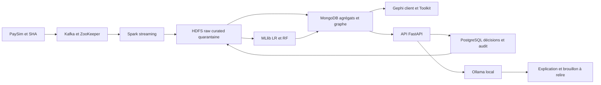
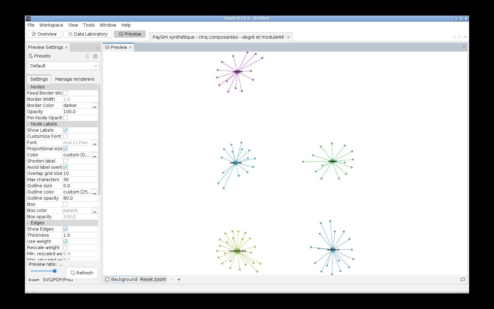
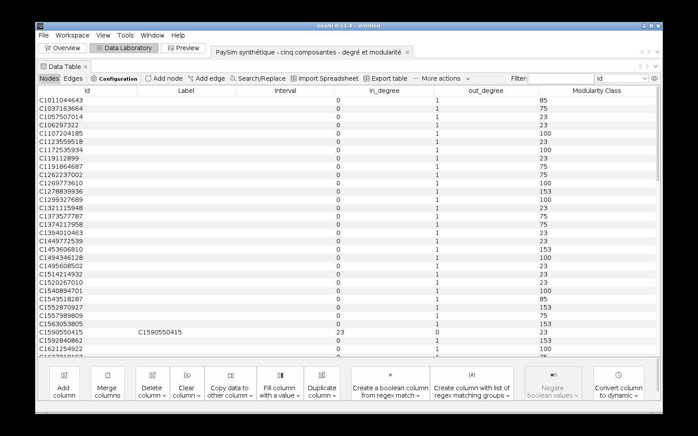

# Rapport technique BC1 — Fraude et réseaux financiers

État documenté du 18 novembre 2026. Candidat : Thomas Gassmann. Réalisation individuelle avec assistance Codex pour l’ingénierie et les vérifications. Échéance non communiquée. Les explications et la validation devant le jury restent sous la responsabilité du candidat. Ce rapport décrit les exécutions réelles et leurs limites ; il ne constitue pas une validation RNCP. Les contrôles de sécurité forte et de bascule HDFS ont été testés dans des profils isolés ; leur intégration au principal et la disponibilité globale restent ouvertes. La reproduction sur des volumes métier neufs est décrite ci-dessous, avec réemploi explicite des images et fichiers acquis.

## Besoin et périmètre

Le projet rejoue des transactions synthétiques PaySim dans une plateforme Big Data, conserve leur provenance, construit un graphe de comptes, compare deux modèles de fraude et génère un brouillon à partir d'une alerte. Une suspicion statistique ne devient pas une accusation bancaire. Aucun email n'est envoyé.

Le sujet pédagogique impose Kafka/ZooKeeper, Spark/PySpark/SQL, HDFS/Parquet, un Data Lab NoSQL, Gephi, LR/RF MLlib et une génération LLM effective. PostgreSQL, l'API, la seconde source, les contrôles d'intégrité, les mesures et la résilience complètent C1.1–C2.4 du référentiel fourni. Les alternatives et écarts sont détaillés dans [l'audit](audit.md) et [la matrice](rncp-matrix.md). BC2 et BC3 n'ont pas été commencés.

## Données et limites de validité

PaySim v2 d'Edgar Lopez-Rojas, source Kaggle `ealaxi/paysim1`, licence CC BY-SA 4.0 enregistrée dans les métadonnées acquises. Le fichier intégral a été profilé : 6 362 620 lignes, onze colonnes, 8 213 labels fraude, soit environ 0,1291 %. Zéro ligne invalide selon les contrôles implémentés, pas selon une garantie universelle de qualité. Empreinte CSV, licence, distributions et limites dans [dataset.md](dataset.md) et [le profil réel](evidence/p1/paysim-profile.json).

Les montants restent décimaux, sans devise inventée. Le step est une heure simulée ; l'origine du temps d'événement est fixée au 1er janvier 2000 UTC et marquée synthétique. Le temps de rejeu réel est distinct. Les quatre soldes PaySim sont exclus des prédicteurs conformément à l'avertissement de l'auteur sur les annulations de fraude ; labels et identifiants de compte sont également exclus avant l'inférence.

La source PostgreSQL contient des dossiers et décisions d'investigation. Les décisions produites par les tests portent `origin=automated_test` : aucune revue humaine n'est prétendue. Un snapshot de deux décisions a été extrait via JDBC et joint aux transactions HDFS. L'adéquation pédagogique de cette variété de sources reste à confirmer ; réencoder un CSV en JSON n'aurait pas constitué une seconde source.

## Architecture et contrats

L'identité d'une transaction est le SHA-256 de l'empreinte dataset et de sa position source, indépendante du run. Le producteur vérifie le fichier et attend les acquittements Kafka. Spark valide les champs, conserve le brut et les coordonnées Kafka, typifie les montants, met les événements invalides en quarantaine et déduplique curated par ID. Les checkpoints sont distincts par requête ; l'état RocksDB couvre le rejeu fini sans expiration arbitraire des identités. Sa croissance interdit de prétendre à un service infini déjà dimensionné.

Les métriques portent sur la minute réelle d'émission et le type. Les snapshots complets sont publiés par batch. Les écritures HDFS, Mongo et SQL ne forment pas une transaction distribuée ; IDs stables, upserts et rapprochements limitent les doublons, sans revendication d'exactly-once global. Le snapshot de graphe est marqué complet en dernier. Le registre SQL est normalisé, avec PK/FK/contraintes, décisions immuables et verrous transactionnels d'idempotence.

Le choix MongoDB permet les agrégats, graphes, scores et textes dans un même Data Lab. Cassandra aurait nécessité davantage d'exploitation sans bénéfice démontré à ce volume. PostgreSQL protège les dossiers et décisions ; HDFS conserve les transactions canoniques. MLlib s'entraîne sur HDFS, sans perdre le détail dans un graphe agrégé. L'[architecture détaillée](architecture.md) précise interfaces, schémas, alternatives et ressources.

## Vérification du flux et de l'API

Le contrôle borné `runtime-v1` rapproche les 1 000 premières transactions et toutes les sommes par type. La réutilisation des checkpoints puis le redémarrage Kafka/NameNode/DataNode ont conservé les données. Sa latence p95 logique de 87,43 s comprend le démarrage différé du consommateur ; elle n'est pas un temps de traitement permanent.

L'essai permanent a ensuite émis 1 000 transactions à environ 50/s. Après rejeu des mêmes transactions et injection de trois événements volontairement invalides :

| Indicateur | Résultat observé |
|---|---:|
| Messages bruts | 2 003 |
| Transactions curated uniques | 1 000 |
| Doublons supprimés après reprise | 1 000 |
| Rejets type / destination / montant | 1 / 1 / 1 |
| Comptages, IDs et sommes contre CSV | Identiques |
| p95 émission → timestamp du batch | 8,2806 s |

Cette dernière latence exclut le commit et la visibilité de lecture. Des dépassements du trigger 5 s ont été observés. Une émission de vingt secondes ne remplace pas un benchmark prolongé. [Preuve complète](evidence/p3/live-verification.json).

L'API REST/OpenAPI expose des consultations bornées, dossiers, décisions et génération. Tokens hachés/révocables, rôles lecteur/analyste, quota SQL atomique 60/minute et 5 générations/minute. Six tests HTTP réussis couvrent notamment références inconnues, bornes, refus d'écriture, idempotence et quota ; quatre appels concurrents identiques créent une seule décision. Révocation réelle 200→401 et panne Mongo 503→200 vérifiées. Les quotas n'indiquent pas la capacité du service.

L'API est non root, read-only, sans montage du `.env` ou du dataset brut, sans identités propriétaires ni jetons clients dans son environnement. Les journaux omettent headers, paramètres et corps. Les ports publiés sont limités au loopback. [Isolation](evidence/p8/api-isolation.json), [permissions](evidence/p8/permissions.json), [tests API](evidence/p4/http-tests.json).

## Analyse Gephi

Mongo a fourni 1 597 nœuds et 1 000 arêtes orientées. Le poids représente la fréquence, et le montant total est un attribut distinct. Tous les degrés ont été rapprochés indépendamment du CSV ; les comptages du GEXF ont été contrôlés.

Gephi Toolkit 0.11.4 a calculé une modularité pondérée **0,995408**, résolution 1, aléa désactivé, sur sa projection non orientée. Le graphe possède 597 composantes faibles et 597 communautés. La formule des composantes déconnectées retrouve cette valeur : la fragmentation explique la modularité élevée, sans établir un réseau organisé. Le degré entrant maximal est 23 pour le compte synthétique `C1590550415` ; degré sortant 0.

Pour la lisibilité, les cinq plus grandes composantes (88 nœuds, 83 arêtes) ont été disposées et sauvegardées dans un projet portable. Le logiciel client Gephi Linux 0.11.4 l'a réellement ouvert sur un écran X11 isolé. Les captures suivantes montrent le client, contrairement au rendu SVG/PNG du Toolkit :

Le graphe complet a été exporté avant ce filtre. Les numéros de classes et couleurs sont arbitraires ; comparer les appartenances, pas les IDs de communautés. Aucun label réseau de blanchiment n'existe dans PaySim pour valider une telle conclusion. [Manifeste du client](evidence/p5/desktop-manifest.json), [résultats et degrés](gephi.md).

## Modélisation MLlib

Sélection SHA déterministe indépendante du label, modulo 64 et seed 42, sur le fichier complet : 98 813 transactions et 141 fraudes. Partitionnement par steps complets, prétraitements/pondérations sur train seulement :

| Partition | Période simulée | Transactions | Fraudes |
|---|---|---:|---:|
| Train | step ≤281 | 59 399 | 54 |
| Validation | 282–355 | 20 029 | 20 |
| Test réservé | >355 | 19 385 | 67 |

Variables : log-montant, type encodé, sinus/cosinus de l'heure simulée. LR régularisée et RF de quarante arbres, seed 42, réellement entraînées/sauvegardées. Le seuil est choisi par F2 validation ; le modèle par PR-AUC validation. LR est retenue avant consultation du test, même si RF obtient ensuite une PR-AUC test légèrement supérieure.

| Mesure sur test, seuil 0,7 | LR retenue | Random Forest |
|---|---:|---:|
| Vrais positifs | 37 | 24 |
| Faux positifs | 937 | 468 |
| Vrais négatifs | 18 381 | 18 850 |
| Faux négatifs | 30 | 43 |
| Rappel | 55,22 % | 35,82 % |
| Précision | 3,80 % | 4,88 % |
| ROC-AUC | 0,92043 | 0,88951 |
| PR-AUC | 0,09164 | 0,09588 |

Une baseline toujours négative atteint 99,65 % d'accuracy et zéro rappel : l'accuracy seule est trompeuse. LR détecte davantage de fraudes au prix de nombreuses fausses alertes. Les vingt fraudes de validation rendent les choix instables ; le décalage temporel et le caractère synthétique limitent la généralisation. Aucun usage bancaire de production n'est justifié. Toute nouvelle optimisation doit préserver une nouvelle évaluation indépendante, sans ajuster les paramètres sur le test déjà observé.

Le modèle sauvegardé a été rechargé pour scorer 1 000 transactions, sans labels ni soldes en entrée : 305 alertes, pas 305 fraudes. Une relance conserve 1 000 scores uniques et 305 alertes. La décomposition additive du logit LR a été vérifiée contre la marge réelle du modèle sur toutes les lignes, tolérance 1e-8. Les contributions sont relatives au vecteur nul, une référence algébrique pouvant être hors distribution ; elles ne sont ni une preuve causale ni une comparaison à un client typique. [Rapport ML](evidence/p6/model-comparison.json), [rejeu du scoring](evidence/p6/scoring-replay.json).

## Génération explicative

Qwen 1.5B a produit des sorties rejetées : devise inventée, lecture probabiliste du score, répétition et JSON tronqué. Qwen 3.1B Q4_K_M est verrouillé par digest ; sa licence recherche/évaluation non commerciale est conservée. Les poids ne sont pas publiés.

Deux appels réels séparent le conseiller du client. Le conseiller reçoit score/seuil et faits calculés ; le client reçoit la référence synthétique, sans montant pour éviter une devise inventée. Exemple de style explicite dans le prompt, contrôles structurels/factuels, chronométrage et hashes conservés. Un texte structuré mais parasité a été reclassé en rejet de qualité après revue technique ; les tests ont été renforcés. Une réponse HTTP positive n'est donc pas une validation suffisante du texte.

La version v6 a généré des sorties conformes sur un faux positif PaySim (ligne 282) et un vrai positif (ligne 252), labels conservés uniquement pour l'évaluation hors LLM. La version v7 ajoute le facteur issu de la décomposition LR ; deux sorties réelles v7 sont conservées, sur faux positif et vrai positif. La première contient une coquille de français (« factor »), conservée dans le texte brut et signalée pour revue humaine. Le score reste non calibré, aucune accusation certaine, URL, demande de secret ou contact fictif n'est autorisé. Les brouillons doivent être relus par un humain avant usage ; aucun envoi n'a été réalisé. [Preuves de génération](evidence/p7/generated-draft.json).

## Performance, résilience et limites

| Expérience locale | Résultat et portée |
|---|---|
| SQL, table temporaire synthétique 100 000 lignes | Seq Scan→Index Scan ; p95 14,85→0,36 ms au premier passage, 35,21→0,39 ms au second ; intégrité conservée, variabilité déclarée |
| API, 50 lectures à 5/s | Zéro erreur, p95 36,31 ms ; cache chaud, un client, pas une capacité de production |
| Spark, un puis deux workers | Résultat SHA identique ; médianes 1,5444 et 1,4562 s ; faible gain variable, pas une scalabilité linéaire |
| Copie Parquet partitionnée par type | Égalité multiensemble sur toutes les colonnes ; requête TRANSFER/step>355 : vingt fichiers lus contre un, médianes 0,6023 et 0,3520 s |
| Kafka RF3/ISR minimal 2 | Leader 1 arrêté pendant émission, leader 101 élu ; 220 messages acquittés et relus, zéro perte/doublon observé ; latence d'acquittement maximale 1,022 s |
| Restauration SQL/Mongo/HDFS | Nouvelles bases/chemins isolés, contrôles de comptes et contenu selon protocole ; même hôte, pas une reprise après sinistre |

Les trois répétitions Spark ont une nouvelle QueryExecution pour éviter de réutiliser un échange du premier calcul. La copie Parquet ne change pas curated ; les gains mesurés ne sont pas extrapolés à toutes les requêtes. Kafka conserve un ZooKeeper unique et l'essai porte sur un topic dédié ; le retour des trois ISR a été observé après redémarrage. Ni cette bascule ni une persistance après arrêt ne prouvent une HA de toute la plateforme. [Preuves P8](progress.md).

Restent à traiter ou faire arbitrer explicitement : intégration des profils sécurisés au flux principal, disponibilité SQL/Mongo/API et perte physique de l’hôte, sauvegardes chiffrées/hors hôte, couverture complète des audits d’images, installation sur une machine vierge, répétition orale et publication autorisée. Aucun écart n'est masqué sous une compilation réussie.

## Audit de dépendances et reproduction métier

Un audit Python réel a trouvé deux avis distincts concernant kafka-python 2.3.1. La dépendance est passée à 2.3.2, avec empreinte de roue vérifiée, image reconstruite et deux régressions sur les limites de trame et le coût SCRAM exécutées localement et en conteneur. Le nouvel audit runtime et celui des dix-huit dépendances API ne signalent aucun avis connu. Cette conclusion ne couvre ni OS, ni JAR, ni l'ensemble du code. [Résultats et sources](evidence/p8/dependency-security-summary.json).

La chaîne a été reconstruite dans un projet Compose séparé, sans ports publiés, avec nouveaux volumes métier. Images, CSV vérifié et poids publics déjà acquis sont réutilisés ; aucune clé privée Ollama partagée. Même découpage et métriques de test ML, mêmes CSV de graphe par SHA ; scoring, API, snapshot de quatre décisions automatisées et génération réelle exécutés. Le correctif Kafka est intervenu après le rejeu/entraînement initial ; un nouveau préfixe de 1 000 lignes a été émis et rapproché sous la dépendance corrigée.

Le retour au principal a révélé un `NodeExists` d'enregistrement Kafka. L'expiration automatique d'une ancienne session ZooKeeper a été observée, puis la relance avec configuration identique a réussi, sans suppression. Données HDFS rapprochées et 1 000 scores/305 alertes/huit décisions SQL relus ; digest Qwen présent. Ce résultat ne prouve pas un démarrage sans incident ni une installation sur machine vierge. [Journal](evidence/p9/reproduction.json), [portée/procédure](reproduction.md).

## Maintenance du runtime HDFS

Un contrôle réel supplémentaire révèle CentOS Linux 7 et Java 8u212 dans l'image HDFS 3.4.2 initiale. Un candidat Hadoop 3.4.3/Temurin 11.0.33/Ubuntu 24.04 est construit depuis archive officielle vérifiée et image Java par digest. Écriture/relecture de 1 000 lignes, redémarrage et lecture d'un clone complet du lac ont été testés. Les 98 813 lignes d'entraînement, le rapport et les empreintes de chacun des deux ensembles de 1 000 scores sont identiques au principal.

Après la préparation isolée et la reprise demandée par l’utilisateur, le principal a basculé sur ce runtime. Une nouvelle copie cohérente des volumes et les secrets existants ont été conservés ; sélection persistante par COMPOSE_FILE. Données et modèles relus identiques, checkpoints repris ; le journal décrit les contrôles et l’incident d’inscription du worker Spark. Cette mise à jour ne prouve ni un audit complet des JAR ni une activation Kerberos/TLS. [Dossier et preuves](hadoop-runtime.md).

## Contrôles supplémentaires de sécurité et de disponibilité

HDFS isolé : Kerberos, SASL privacy, HTTPS/SPNEGO et permissions ont été réellement vérifiés. Alice a écrit/relu exactement 1 000 lignes PaySim. Un faux utilisateur sans ticket et Bob avec ticket mais sans droits ont été refusés. HTTPS anonyme, mauvaise CA et mauvais nom ont été refusés. Ces volumes et identités sont distincts du principal.

Kafka isolé : 1 000 lignes du préfixe vérifié ont été transmises et relues à l’identique sous TLS 1.3 / TLS_AES_256_GCM_SHA384. Les certificats producer/consumer ont des ACL distinctes. Absence de certificat, mauvaise CA, mauvais hostname, certificat valide sans ACL et écriture sur topic interdit ont été refusés. ZooKeeper reste en clair sur réseau interne. [Preuve Kafka](evidence/p8/secure-kafka/verification.json).

Spark isolé : un calcul distribué authentifié a produit la somme de carrés attendue 333 283 335 000. Un client avec secret incorrect a reçu des erreurs d’authentification, sans résultat, puis a été arrêté par timeout après 35 s. Le chiffrement RPC est configuré avec fallback SASL désactivé et chiffrement des fichiers locaux activé. Aucune capture réseau ni protection TLS de l’interface Web n’est revendiquée. [Preuve Spark](evidence/p8/secure-spark/verification.json).

HDFS HA isolé : deux sens de bascule automatique après SIGKILL du NameNode actif, 80 fichiers acquittés et relus exactement dans chaque essai. Durées maximales d’écriture observées 4,023 et 11,236 s. Le fencer SSH à commandes forcées a aussi réellement arrêté un standby lors d’un essai distinct. Les services partagent un hôte ; ce profil utilise l’authentification simple et n’est pas combiné au profil Kerberos. [Protocole et limites](hdfs-ha.md).

Audit Trivy OS/JAR réel sur l’image HDFS sécurisée : 555 correspondances initiales, 145 après maintenance ; neuf critiques initiales, zéro après, mais 34 élevées résiduelles. Netty, Bouncy Castle et JSch sont alignés et vérifiés par empreinte à la construction. Les contrôles HDFS autorisés/refusés ont été rejoués après maintenance. L’image principale n’a pas reçu ces mêmes substitutions JAR. Un audit complémentaire a maintenant couvert les sept images principales ; les variantes optionnelles et le client Gephi restent hors de ce périmètre. Il n’y a ni preuve d’exploitation des avis dans ce contexte, ni acceptation humaine du risque. [Audit et portée](evidence/p8/dependency-scan/summary.json).

Les sept images principales présentent encore des correspondances critiques ou élevées, parfois répétées dans les JAR embarqués. Le scan a terminé, mais ces résultats ne constituent pas une sécurité validée. Une lecture contextuelle des deux correspondances critiques de l’API est documentée sans masquer les résultats bruts. [Tableau complet, empreintes et limites](security-profiles.md). La remédiation complète et l’intégration des profils sécurisés restent ouvertes.

## Démonstration technique finale de la campagne

Le run neuf `jury-20261118-v1` a rejoué 1 000 transactions acquittées en 10,001 s. Spark a publié 1 000 transactions uniques, zéro rejet et les mêmes identifiants/sommes que le CSV. Mongo a reçu le graphe de 1 597 nœuds/1 000 arêtes. Le modèle déjà sauvegardé a produit 1 000 scores/305 alertes, sans réentraînement présenté comme direct. L’API a retourné une alerte persistée et enregistré les deux sorties Qwen réelles.

La première génération a échoué au chargement après 90 s, avec réponse 503, sans brouillon substitué. Préchauffage puis nouvelle tentative : 88,026 s cumulées côté modèle, chargement compris. La coquille « factor » reste dans le texte brut, à corriger par revue humaine. Durée observée de tout le parcours : 1 600,667 s, incluant pauses documentaires/audits/reprise ; ce n’est pas la durée d’un oral continu. [Journal complet](evidence/p9/demonstration.json), [sortie réelle](evidence/p9/demonstration-draft.json).

Les tests supplémentaires refusent un broker inaccessible (zéro acquittement) et interrompent proprement le producteur (code 130, aucun fichier JSONL partiel publié). Le contrôle préalable des checkpoints refuse l’absence/corruption de métadonnées devant une sortie existante, avant de démarrer les sinks. Spark conserve la validation approfondie des offsets et fichiers d’état. [Tests et limites](testing.md).

## Reproduction, soutenance et état de livraison

[Installation](installation.md), [plan](implementation-plan.md), [tests](testing.md), [progression](progress.md), [préparation au jury](jury-preparation.md). Les sources, versions, empreintes et preuves sont séparées des données/poids/secrets ignorés. Aucun BC2/BC3 ni service payant n'a été créé. Le dépôt est local ; publication publique et accès jury nécessitent un accord distinct.

Le rapport et le support PDF sont disponibles. Le projet n'est pas déclaré entièrement prêt : sécurité intégrée, remédiation restante, répétition orale, installation sur machine vierge et publication autorisée restent ouvertes. La validation officielle du bloc appartient au jury.
